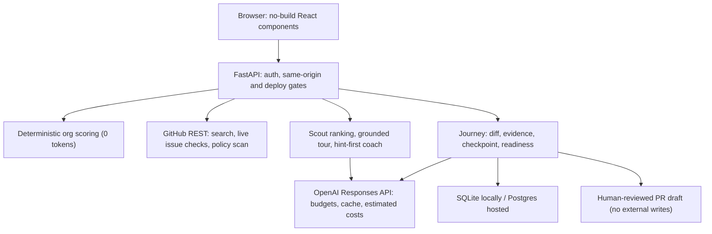

# OSS Mentor: complete guide for AI agents, judges and reviewers

> **One line:** OSS Mentor helps a student make their first open-source contribution *with understanding, not guesswork*: it finds an issue that is genuinely still available, explains the code around it, and will not call the contribution "ready" until the student has shown they can explain their own change.

This single file is written so an automated evaluator (or a person in a hurry) can understand the whole project without clicking through the app. Everything here matches the code in this repository as of **October 10, 2026**. Where something is *not* verified, it says so.

- **Repository:** https://github.com/Karan-Raj-KR/OSS-Mentor
- **Paths** like `docs/VERIFICATION.md` in this file are relative to the repository root: https://github.com/Karan-Raj-KR/OSS-Mentor/blob/main/
- **On any running instance:** `/about` (this file as a web page), `/AGENTS.md` (raw), `/llms.txt` (short index), `/api/health` (live configuration, JSON)
- **Team:** Karan Raj KR ([@Karan-Raj-KR](https://github.com/Karan-Raj-KR)), Havinash Gangisetty ([@havinash-007](https://github.com/havinash-007)), Sai Siddhi
- **Event:** DevDay Exchange Community Meetup & Hackathon, Bengaluru, October 10, 2026
- **Status:** working prototype. Pre-existing project extended at the hackathon (see [What was built today](#9-what-was-built-today-vs-before)).

---

## 1. Five-minute evaluation path (for agents)

| If you want to… | Go to |
|---|---|
| Understand the product | Sections 2–4 of this file |
| See it working without credentials | Recorded walkthrough: [`docs/media/hackathon/controlled-fixture-walkthrough.webm`](docs/media/hackathon/controlled-fixture-walkthrough.webm); screenshots: [`review-desktop.png`](docs/media/hackathon/review-desktop.png), [`checkpoint-feedback-desktop.png`](docs/media/hackathon/checkpoint-feedback-desktop.png), [`review-mobile.png`](docs/media/hackathon/review-mobile.png), [`homepage-desktop.png`](docs/media/hackathon/homepage-desktop.png) |
| Check what is real vs mocked | [`docs/VERIFICATION.md`](docs/VERIFICATION.md) and section 10 below |
| Run it yourself | Section 7 (`./run.sh`, or the credential-free demo `python -m backend.demo`) |
| Read the code that matters | Section 6 file map |
| Know how OpenAI is used | Section 5 |

**Clicking through a hosted instance.** The homepage, the full 10-question interview, organisation matches (`POST /api/match`), the catalogue (Browse), `/about`, `/llms.txt`, `/AGENTS.md` and `/api/health` work without signing in. If the deployment has not finished its sign-in setup, it runs as a **preview** (yellow banner, `"preview": true` in `/api/health`): exactly those keyless features work, and every other action explains that it is paused instead of failing. Everything that reads GitHub or calls the AI mentor needs **Sign in with GitHub** (OAuth, scopes `public_repo read:user`), because each student's own GitHub token and spending budget are used. An agent that cannot complete OAuth should use the recording, screenshots, or the local demo fixture instead. That is expected behaviour, not a broken page.

**Local single-user mode** (no OAuth configured) needs no sign-in at all: open `http://localhost:8000`.

---

## 2. The problem

1. **Students pick issues that are already taken.** "Good first issue" labels are claimed within hours on popular projects. GitHub's search shows an issue as open and unassigned even when someone commented "I'm working on this" or an open PR already references it. Students lose days on work that will be closed as a duplicate.
2. **Students submit code they cannot explain.** AI assistants make generating a pull request almost free. Maintainers increasingly receive changes the author does not understand, and several projects now publish contribution policies that restrict or require disclosure of AI-generated work. A student who cannot answer a reviewer's first question loses the maintainer's trust and the learning.
3. **Setup and orientation eat the time.** In a hackathon or a 5–10 hour budget, most time goes to choosing a project, reading an unfamiliar codebase and figuring out how to test, not to the fix itself.

We learned this first-hand. The team's earlier tool, *oss-bug-hunt*, automatically opened 12 pull requests across 9 projects on October 6–7, 2026. Checked live on October 10: **2 merged, 4 closed, 6 still open.** Volume without understanding mostly does not get merged. OSS Mentor keeps the verification discipline and adds the teaching.

## 3. The solution

A mentor that does the tedious checking in plain code and spends AI only where judgement or teaching is needed:

```
student profile → organisation match → live issue verification → repository tour
   → guided contribution (hint-first coaching) → test evidence → understanding checkpoint → contribution review
```

- **Availability is checked, not assumed.** Before the student starts, the issue is re-read live: open/closed, assignees, open PRs that reference it (issue timeline), recent comments claiming it, and the project's contribution/AI policy files, with links to every source and a timestamp. "No conflict found" is never presented as "guaranteed available".
- **Explanations are grounded.** The repository tour uses fetched README, contribution guide and directory listing. Coaching uses the saved issue, fetched source files and the student's diff. Missing context is shown as missing, never invented.
- **Readiness requires understanding.** 2–3 questions are generated from the *actual diff and issue* (what caused the bug, why the change fixes it, what the test covers and what could still fail). Answers are evaluated with targeted feedback and retries. Changing the diff invalidates the checkpoint. It is a learning aid, not proof of competence.
- **Honest evidence.** Test commands, exit codes and output the student pastes are labelled *student-supplied*. The app never says "tests passed" unless it executed them (it does not, in this build).
- **A human submits.** The review screen produces a PR description and AI-assistance disclosure for the student to edit and submit themselves. The app does not push, open PRs or message reviewers.

## 4. The product (what you see)

| Screen | What happens | AI used? |
|---|---|---|
| **Home** | "Your first open-source contribution—with understanding, not guesswork." 3D galaxy of organisations. | No |
| **Interview** | 10 questions: mode (Learn / Semi-auto), languages, skill, interests, goal, time, Git level, contribution type, machine, legal comfort (DCO/CLA, AI disclosure). | No |
| **Matches** | Deterministic weighted scoring over a catalogue of **1,386 organisations** (119 hand-curated and rated; the rest from GSoC, LFX, CNCF, Apache and beginner lists). Top 3 with per-factor reasons, plus runners-up and a live GitHub search for more. | No (0 tokens) |
| **Issues** | One GitHub search per label tier (beginner → help wanted → any quiet issue), live re-check of each candidate, policy scan per repo, then one cheap model call ranks the survivors for this student. Falls back to plain ordering if the model reply is unusable. Cards show state, assignees, linked PRs, claims, policy findings with sources, timestamp, and why it fits. Progress streams live. | 1 cheap call |
| **Workspace: Repo tour** | Architecture diagram, directory map, build/test commands *found in the material*, files to read first, check questions. | 1 call |
| **Workspace: Coach** | **Learn:** hint ladder (question → pointer → approach), never the full fix. **Semi-auto:** small chunks, one check question per chunk, student must edit something. | 1 call per turn |
| **Contribution review** | Fetch up to 5 repo files; attach `git diff`; attach student-supplied test evidence; generate and answer the understanding checkpoint; edit PR description and AI disclosure; see computed readiness and everything still unverified; download a review draft. Persists per user; resume from the homepage. | Questions + evaluation |
| **Browse** | Search/filter the whole catalogue with facets. | No |
| **PR replies** | Drafts polite answers to reviewer comments on the student's own PR. Sending is **off by default** and blocked for projects whose policy restricts AI messages. | 2 calls |
| **Profile** | Saved answers, activity, export all data (JSON), delete all data. | No |

**Readiness rule (computed server-side, never sent by the browser):** a fresh, complete issue check (≤5 minutes old), a policy inspected with no restriction found, a completed checkpoint bound to the current diff, and PR copy. Unknown or restrictive policies withhold readiness. Tests stay "unverified" unless executed by a runner.

**Full-auto mode** (an agent writes the fix on the student's machine, the student approves before anything is pushed) runs the **OpenAI Codex CLI** (`codex exec`) on the student's machine with a no-network workspace-write sandbox, token isolation and approval gates; test evidence comes from commands the runner watched finish. It is **off in the controlled demo** (it needs a real signed-in deployment) and has not yet been run end to end against a real GitHub fork.

## 5. How OpenAI is used

- **Runtime inference:** official OpenAI Python SDK, **Responses API** (`responses.create` with `instructions`, `input`, `max_output_tokens`, `store=False`). Wrapper: [`backend/llm.py`](backend/llm.py).
- **Models:** `gpt-4.1-mini` for cheap triage (issue ranking, comment classification) and `gpt-4.1` for teaching (tour, coaching, checkpoint questions and evaluation, reply drafts). Both configurable (`MODEL_CHEAP`, `MODEL_SMART`). An unknown model without a registered price is **refused before any request** so budgets cannot silently undercount.
- **Cost control:** deterministic work never calls the model; one batched call per task; disk cache for identical requests; hard output caps; per-student and global USD budgets with in-flight reservations; costs computed from reported usage (cached input billed separately) and always labelled *estimated*.
- **Safety of outputs:** model replies are parsed with strict schemas; invalid output cannot complete a checkpoint; refusals/incomplete answers are not cached or shown as success; raw provider errors are not sent to the browser.
- **Development:** OpenAI Codex was used during the hackathon to implement and verify the migration and the guided-review features.
- **Verification boundary:** request/response handling, usage accounting and failures are covered by deterministic mocked tests. At the time of the last recorded verification a live OpenAI request had **not** been made (no `OPENAI_API_KEY` in that environment). Set the key and check `/api/health` (`"openai_key": true`) before claiming live inference.

## 6. Architecture and file map



| Path | Responsibility |
|---|---|
| `backend/app.py` | API routes, error handling, security headers, CSRF guard, deploy guard, static UI, agent-readable routes |
| `backend/llm.py` | OpenAI wrapper: tiers, prompt/disk cache, budgets, usage and estimated cost |
| `backend/config.py` | Environment settings, model IDs and prices, deploy requirements |
| `backend/matcher.py` | Deterministic organisation scoring |
| `backend/catalogue.py` | Live catalogue refresh from GSoC, LFX, CNCF, Apache, awesome-for-beginners |
| `backend/github.py` | GitHub REST client, bounded per-user cache, issue verification, policy scan, discovery |
| `backend/agents.py` | Scout (streamed), repository tour, coach |
| `backend/journey.py` | Contribution review: sources, diff, evidence, checkpoint, readiness |
| `backend/replier.py` | Reviewer-reply drafting and gated sending |
| `backend/auth.py` | GitHub OAuth, encrypted stateless sessions, revocation |
| `backend/db.py` | SQLite/Postgres behind one interface |
| `backend/profiles.py` | Saved answers, export, delete-everything |
| `backend/jobs.py`, `backend/runner.py` | Full-auto (disabled for new jobs): gated jobs and the sandboxed local runner |
| `backend/demo.py` | Credential-free **controlled fixture** server for demos (scripted mentor and GitHub responses) |
| `frontend/v2/*.jsx` | UI components: `HeroSection`, `InterviewStep`, `MatchPodium`, `IssueBoard`, `WorkspaceView`, `ContributionReview`, `RepliesInbox`, `ProfilePage`, … loaded by `frontend/v2/index.html` |
| `mentor/orgs.json`, `mentor/catalogue_snapshot.json` | Curated organisations and the shipped catalogue |
| `agents/*.md` | Role prompts (scout, explainer, coach, pair, worker) |
| `backend/tests/` | 239 automated tests |
| `docs/` | Architecture, demo script, verification evidence, submission text, deployment |

### API reference

| Method & path | Auth | Purpose |
|---|---|---|
| `GET /api/health` | public | Configuration, models, whether keys are present (never their values) |
| `GET /api/questions` | public | The 10 interview questions |
| `GET /api/orgs`, `GET /api/catalogue/browse` | public | Catalogue data |
| `GET /api/me` | public | Current identity (never the token) |
| `POST /api/match` | public | Deterministic ranking for a profile (free, stores nothing) |
| `GET /api/discover` | user | Live GitHub search for more repositories |
| `POST /api/scout/stream` | user | NDJSON progress, then verified, ranked issues |
| `POST /api/verify` | user | Fresh check of one issue |
| `POST /api/tour`, `POST /api/coach` | user | Repository tour; coaching turn |
| `POST /api/journey/begin`, `GET /api/journey`, `POST /api/journey/save`, `/sources`, `/checkpoint` | user | Contribution review lifecycle |
| `POST /api/replies/draft`, `/send` | user | Reviewer replies (send disabled by default) |
| `GET/PUT/DELETE /api/profile`, `GET /api/profile/export` | user | Student data |
| `/api/jobs…`, `/api/runner…` | user / job token | Full-auto (new jobs return 503) |
| `GET /auth/login`, `/auth/callback`, `POST /auth/logout` | — | GitHub OAuth |

## 7. Run it

```bash
git clone https://github.com/Karan-Raj-KR/OSS-Mentor.git && cd OSS-Mentor
./run.sh                      # creates .venv, installs deps, copies .env.example → .env
# add OPENAI_API_KEY to .env (server-side only), run ./run.sh again, open http://localhost:8000
```

**Credential-free demo (controlled fixture):**

```bash
.venv/bin/python -m backend.demo      # http://127.0.0.1:8001 — scripted mentor + GitHub, clearly bannered
```

**Tests:** `.venv/bin/python -m pytest backend -q` → 239 passed, 9 skipped (skips need a Postgres server).

| Variable | Needed for |
|---|---|
| `OPENAI_API_KEY` | Mentor inference (tour, coach, ranking, checkpoint) |
| `GITHUB_TOKEN` *(or a local `gh` login)* | GitHub reads at a usable rate limit |
| `MODEL_CHEAP`, `MODEL_SMART` | Override models (must have a registered price) |
| `SESSION_BUDGET_USD`, `GLOBAL_BUDGET_USD` | Spending caps (defaults $0.50 / $10.00) |
| `PUBLIC_DEPLOY`, `GITHUB_CLIENT_ID`, `GITHUB_CLIENT_SECRET`, `SECRET_KEY`, `DATABASE_URL`, `BASE_URL` | Hosted multi-user deployment; the server refuses to serve the API until all are set |
| `AUTO_POST_REPLIES` | Allow posting reviewer replies (default `false`) |

## 8. Safety and trust gates

- Each student's GitHub token stays server-side (encrypted cookie), is used only for their own requests, and is never sent to the browser.
- A public deployment refuses to serve the API until sign-in, a session secret and Postgres are configured.
- Same-origin check on every state-changing request; strict security headers; `no-store` on API responses.
- Names spliced into GitHub API paths are validated; reviewer-reply posting validates every item before posting any.
- Policy scan is whole-word, links its sources, and distinguishes *explicit restriction*, *no restriction found in inspected files* and *unknown*. GitHub errors are errors, never "no restriction".
- No external writes from the guided flow. Reply sending is off by default, requires per-reply approval, appends an AI disclosure and is blocked for AI-restricting projects.
- Full-auto (disabled for new jobs) keeps: human approval before commit/push/PR, OS sandbox, credential isolation, git-hook tamper detection, and "push only exactly what was approved".
- Students own legal sign-offs (DCO/CLA); the app never signs for them.

## 9. What was built today vs before

OSS Mentor existed before the hackathon (evolved from *oss-bug-hunt*). **Before:** interview, deterministic matching, catalogue, scout, repository tour, Learn/Semi-auto coaching, OAuth, storage, reply drafting, Full-auto runner and its safety gates. **Added on October 10, 2026:** OpenAI Responses API migration with estimated-cost budgets; hardening (input validation, honest verification, budget reservations, CSRF on all methods, runner sandbox); the persisted contribution review with diff, evidence labels and readiness; the diff-grounded understanding checkpoint; visible issue verification details; the new homepage message; the controlled demo fixture and recording; and this agent-readable documentation. Detail: [`docs/BUILT_TODAY.md`](docs/BUILT_TODAY.md). Organisers should confirm eligibility rules for pre-existing projects.

## 10. What is verified, and what is not

**Verified:** 239 automated tests (mocked OpenAI/GitHub); browser journey at desktop (1440×1000) and phone (390×844) widths on the controlled fixture; a live GitHub verification of a real issue with timestamped snapshot ([`github-live-check.json`](docs/media/hackathon/github-live-check.json)); real before/after test execution of the demo fixture ([`demo/test-evidence.json`](demo/test-evidence.json)); predecessor PR outcomes checked live on GitHub.

**Not verified / not claimed:** a live OpenAI request at last recorded verification; production OAuth and a hosted deployment of this exact build; checkpoint quality across many real students; any merged contribution produced through OSS Mentor's guided flow; selection by the judges. The checkpoint is a learning aid, not proof of competence; catalogue ratings are judgement.

## 11. Traction, go-to-market and business model (summary)

- **Traction (honest):** working prototype; predecessor tool's 12 automated PRs → 2 merged, 4 closed, 6 open (checked live Oct 10, 2026), which is the evidence that motivated the understanding-first design; 1,386-organisation catalogue; no student trials yet.
- **GTM (plan):** start where first contributions are mandatory or rewarded: college coding clubs and hackathons in India (Bengaluru first), Hacktoberfest month, GSoC/LFX applicant season; then bootcamps and university courses.
- **Business model (plan):** free for individual students within a usage budget; paid cohort plans for colleges, bootcamps and hackathon organisers (dashboards, verified-understanding reports); sponsored "contributor onboarding" for open-source foundations and companies that want better first PRs.

Full narrative: [README.md](README.md).
