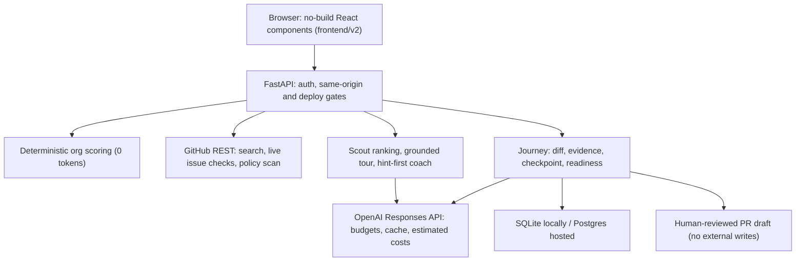

# OSS Mentor

### Your first open-source contribution—with understanding, not guesswork.

Find a suitable issue, understand the code, and prepare a contribution you can explain.

**Team:** Karan Raj KR · Havinash Gangisetty · Sai Siddhi
**Built for:** DevDay Exchange Community Meetup & Hackathon, Bengaluru, October 10, 2026
**Status:** working prototype. An existing project, extended at the hackathon ([what was built today](docs/BUILT_TODAY.md))

> **AI agents and judges:** everything is in one file, [`AGENTS.md`](AGENTS.md). On a running instance it is at `/about` (web page), `/AGENTS.md` (raw) and `/llms.txt` (short index). No sign-in or JavaScript needed.

---

## Contents

1. [TL;DR](#tldr)
2. [Team](#team)
3. [The problem](#the-problem)
4. [The solution](#the-solution)
5. [The product](#the-product)
6. [How it works](#how-it-works)
7. [Why it works](#why-it-works)
8. [Why now](#why-now)
9. [Traction](#traction)
10. [Go-to-market and business model](#go-to-market-and-business-model)
11. [How we use OpenAI](#how-we-use-openai)
12. [Hackathon: judging criteria and what we built today](#hackathon-judging-criteria-and-what-we-built-today)
13. [Run it](#run-it)
14. [Architecture and code map](#architecture-and-code-map)
15. [Safety, privacy and honesty](#safety-privacy-and-honesty)
16. [Limitations and roadmap](#limitations-and-roadmap)

---

## TL;DR

Students who want a first open-source contribution waste days on issues someone else has already taken, then submit code they can't explain. OSS Mentor fixes both ends:

- **Before coding:** it matches the student to a suitable organisation and **live-verifies** that an issue is still free. It checks assignees, open PRs that reference the issue, recent "I'll take this" comments and the project's AI/contribution policy, and shows the source and a timestamp for each.
- **While coding:** it explains the repository from **fetched files**, not imagination, and coaches **hint-first**.
- **Before submitting:** it asks 2–3 questions generated from the student's **actual diff**, gives targeted feedback, and will not mark the contribution "ready" until the student can explain it. Test results the student pastes are labelled *student-supplied*, never "passed".

A human always submits. OSS Mentor never pushes, opens PRs or messages maintainers on its own.

---

## Team

| Name | GitHub |
|---|---|
| **Karan Raj KR** | [@Karan-Raj-KR](https://github.com/Karan-Raj-KR) |
| **Havinash Gangisetty** | [@havinash-007](https://github.com/havinash-007) |
| **Sai Siddhi** | |

---

## The problem

**1. "Good first issues" are a race students lose.** On popular projects, beginner issues are claimed within hours. GitHub search still shows an issue as *open and unassigned* when someone commented "I'm working on this" an hour ago, or when an open PR already fixes it. A student finds out only after days of work, when their PR is closed as a duplicate.

**2. AI made PRs cheap, and understanding scarce.** Generating a pull request with an AI assistant takes minutes. Maintainers now receive a growing share of changes their authors cannot explain, and projects have responded with contribution policies that restrict AI-generated work or require disclosure. For example, Zulip, one of the most beginner-friendly projects in our catalogue, asks contributors not to submit AI-generated PRs they haven't personally understood. A student who can't answer a reviewer's first question loses the maintainer's trust *and* the learning that was the point.

**3. Orientation eats the time budget.** A student with 5–10 hours, or a team with a 24-hour hackathon, spends most of it choosing a project, reading an unfamiliar codebase and working out how to run the tests. The fix itself is often 10 lines.

**We lived this.** Our earlier tool, *oss-bug-hunt*, used AI agents to find bugs and open PRs automatically: **12 PRs across 9 projects in a day**. Three days later: **2 merged, 4 closed, 6 still open** ([details](#traction)). Automating *volume* doesn't get contributions merged. Understanding does.

---

## The solution

A mentor that does the tedious verification in plain code and spends AI only where judgement or teaching is needed, and that treats **understanding** as the gate, not a nice-to-have.

```
student profile → organisation match → live issue verification → repository tour
     → guided contribution (hint-first) → test evidence → understanding checkpoint → contribution review → human submits
```

| Principle | What it means in the product |
|---|---|
| **Check, don't assume** | Issue availability is re-verified live before work starts and again before "ready". "No conflict found" is never shown as "guaranteed free". |
| **Ground everything** | Tours and coaching use fetched README, contribution guides, directory listings, source files and the student's diff. Missing context is shown as missing. |
| **Teach, don't do** | Learn mode gives a hint ladder (question → pointer → approach), never the full fix. Semi-auto gives small chunks and asks one check question per chunk. |
| **Understanding is the gate** | Readiness requires passing questions generated from the actual diff. Editing the diff resets it. |
| **Honest evidence** | Tests the student ran are labelled *student-supplied*. Anything unverified is listed as unverified. |
| **Human in charge** | The student edits the PR text and AI disclosure, and submits it themselves. Legal sign-offs (DCO/CLA) are theirs. |

---

## The product

| Step | Screen | What the student sees | AI |
|---|---|---|---|
| 1 | **Home** | "Your first open-source contribution—with understanding, not guesswork." An interactive 3D galaxy of organisations. | — |
| 2 | **Interview** | 10 quick questions: mode, languages, skill, interests, goal, time, Git level, contribution type, machine, legal comfort. Saved for next time. | — |
| 3 | **Matches** | Top 3 organisations from a catalogue of **1,386** (119 hand-curated; the rest from GSoC, LFX, CNCF, Apache and beginner lists), each with a per-factor score breakdown, plus runners-up and live GitHub discovery. | 0 tokens |
| 4 | **Issues** | Live progress ("searching… reading policies… double-checking PRs and claims…"), then up to 3 verified issues. Each card shows state, assignees, competing PRs, claim comments, policy findings with links, verification time, and why it fits *this* student. | 1 cheap call |
| 5 | **Workspace: Repo tour** | Architecture diagram, directory map, build/test commands found in the repo, files to read first, self-check questions. | 1 call |
| 6 | **Workspace: Coach** | Hint-first chat grounded in the issue and fetched code. | 1 call/turn |
| 7 | **Contribution review** | Fetch relevant files, attach `git diff`, attach test evidence (labelled student-supplied), answer the **understanding checkpoint** with feedback and retries, edit the PR description and AI disclosure, see computed readiness and what's still unverified, download a review draft. Resume any time. | questions + evaluation |
| — | **Browse** | Search and filter the full catalogue. | — |
| — | **PR replies** | Draft polite answers to reviewers on your own PR. Sending is off by default. | 2 calls |
| — | **Profile** | Your saved data: export it as JSON or delete everything. | — |

Screenshots and a recording (controlled demo fixture): [review, desktop](docs/media/hackathon/review-desktop.png) · [checkpoint feedback](docs/media/hackathon/checkpoint-feedback-desktop.png) · [review, phone](docs/media/hackathon/review-mobile.png) · [homepage](docs/media/hackathon/homepage-desktop.png) · [walkthrough video](docs/media/hackathon/controlled-fixture-walkthrough.webm) · [showreel 16:9](docs/media/oss-mentor-showreel-16x9.mp4)

---

## How it works

**1. Matching (deterministic, free).** A weighted rubric scores every catalogue organisation against the profile: language overlap, interest overlap, beginner-friendliness (adjusted for Git experience), fit with the goal (GSoC, hackathon, job, learning), and setup weight versus the student's machine. CLA-only projects are gated out for students who only accept DCO. Fully explainable, zero AI cost. (`backend/matcher.py`)

**2. Scouting (one search, many checks).** One GitHub issue search per label tier finds open, unassigned issues with no linked PR across a whole organisation, widening from beginner labels to "help wanted" to any quiet issue. An earlier design made a search per issue, hit GitHub's rate limit and treated the errors as "claimed". Survivors are re-checked against the issue timeline (open PRs referencing it) and recent comments (claim phrases, whole-word matched). Each repository's policy files are read once. A single cheap model call ranks the survivors for this student; if its reply is unusable, the scout falls back to a plain-code ordering instead of failing. If an organisation has nothing, it tries the next-best match and says so. (`backend/agents.py`, `backend/github.py`)

**3. Verification you can see.** Starting a contribution forces a fresh, uncached check. Every finding links to its source. Policy results are three-way: *explicit restriction*, *no restriction found in inspected files*, or *unknown*. A failed GitHub read is an error, never "no restriction".

**4. Grounded explanation.** The repository tour is built from the fetched README, contribution guide and directory listing, with instructions to use only that material. In the review, the student fetches up to five relevant files; coaching then uses the saved issue, those files and their diff. (`backend/agents.py`, `backend/journey.py`)

**5. The understanding checkpoint.** From the saved issue and the actual unified diff, the mentor generates 2–3 focused questions: *What caused the problem? Why does this change fix it? What does the test cover, and what could still fail?* Answers are evaluated against the diff with a strict schema, so invalid model output cannot pass anyone. The student gets targeted feedback and can retry. The checkpoint records the diff's SHA-256, so editing the diff, the evidence or the issue/policy state invalidates it. Conditional writes stop a stale evaluation from attaching to a newer diff.

**6. Readiness, computed server-side.** "Ready for human review" requires: a fresh, complete issue check (≤ 5 minutes old), a policy with no restriction found, a completed checkpoint for the current diff, and PR copy. Tests stay *unverified* unless a runner executed them; this build does not run student code.

**7. Cost control.** Deterministic work never calls the model. Each task is one batched call with a hard output cap. Identical requests come from a disk cache. Per-student and global USD budgets are checked before each call using a worst-case estimate reserved while the call is in flight, then reconciled from reported usage. Unknown models without a registered price are refused. All costs are labelled *estimated*. Rough per-step cost: scouting about $0.01, a tour about $0.02, a coaching turn about $0.01; a whole first-issue session is designed to stay under the default $0.50 cap.

---

## Why it works

- **It attacks the two real failure points**: picking a taken issue and submitting an unexplained change. It doesn't add yet another list of "good first issues".
- **Verification is cheap and deterministic.** GitHub's API already holds the truth: assignees, timeline cross-references, comments, policy files. Reading it carefully costs nothing in AI tokens and removes the biggest source of wasted effort.
- **Understanding is checked against the student's own change.** Questions come from the actual diff, so they can't be answered with generic knowledge, and changing the code resets them.
- **It is honest by construction.** Student-supplied evidence keeps its label; unknown stays unknown; the app never claims tests passed, issues are guaranteed free or PRs will be merged. Maintainers and students can trust what it shows.
- **Learning is the product, not a side effect.** Hint-first coaching keeps the student writing the code. This aligns with what maintainers want (contributors who can respond to review) and with what students need (skills and a portfolio they can defend in an interview).
- **Evidence from our own failure.** Our fully automated predecessor got 2 of 12 PRs merged. The difference between "a PR exists" and "a PR is merged" is understanding and fit, which is exactly what OSS Mentor gates on.

---

## Why now

- **AI coding assistants made PRs nearly free to produce.** The bottleneck moved from *writing* code to *understanding and owning* it. Projects are publishing AI contribution policies, and maintainers are filtering harder. Contributors who can explain their change stand out more than ever.
- **Students are being pushed toward open source right now.** October is Hacktoberfest month, Google Summer of Code and LFX applicants are building track records, and hiring managers use open-source contributions as proof of real-world skill. India has one of the world's largest and fastest-growing student developer communities.
- **The models are good enough to teach, and cheap enough to scale.** Generating diff-specific questions and judging free-text explanations is now reliable enough to be useful, and at a few cents per session it can be offered free to individual students.
- **The tooling exists to verify, not just generate.** GitHub's timeline and policy files let a mentor check availability in seconds, so we can combine verification with teaching in one flow.

---

## Traction

We are early and say so plainly.

- **Working prototype** of the full guided journey, covered by **239 automated tests** and a browser-verified walkthrough at desktop and phone sizes ([verification](docs/VERIFICATION.md)).
- **Catalogue of 1,386 organisations**, refreshed from public programme feeds, 119 hand-curated and rated.
- **Predecessor results that shaped the design.** The 12 PRs our automated tool opened on October 6–7, 2026, checked live on GitHub on October 10:

  | Outcome | PRs |
  |---|---|
  | **Merged (2)** | [The-PR-Agent/pr-agent#3966](https://github.com/The-PR-Agent/pr-agent/pull/3966), [paupino/rust-decimal#869](https://github.com/paupino/rust-decimal/pull/869) |
  | **Closed (4)** | [useblocks/sphinx-needs#2103](https://github.com/useblocks/sphinx-needs/pull/2103), [#2104](https://github.com/useblocks/sphinx-needs/pull/2104), [#2105](https://github.com/useblocks/sphinx-needs/pull/2105), [genshinsim/gcsim#3206](https://github.com/genshinsim/gcsim/pull/3206) |
  | **Open (6)** | [sktime/skpro#1200](https://github.com/sktime/skpro/pull/1200), [Kludex/starlette#3643](https://github.com/Kludex/starlette/pull/3643), [vitejs/vite-plugin-vue#856](https://github.com/vitejs/vite-plugin-vue/pull/856), [paupino/rust-decimal#870](https://github.com/paupino/rust-decimal/pull/870), [Rel1cx/eslint-react#2010](https://github.com/Rel1cx/eslint-react/pull/2010), [oras-project/oras#2227](https://github.com/oras-project/oras/pull/2227) |

  These were produced by the earlier fully automated tool, not by OSS Mentor's guided flow.
- **Not yet:** student user trials, a hosted deployment of this exact build, or a merged contribution made through the guided flow. These are the next milestones.

---

## Go-to-market and business model

*This is our plan, not achieved results.*

**Who first.** Students who must or want to make a first contribution, reached through the places that already organise them:
1. **College coding clubs and hackathons in India**, starting with Bengaluru communities like the one hosting this event. Hackathon organisers want "real contribution" tracks that judges can trust.
2. **Programme seasons:** Hacktoberfest (October), GSoC and LFX application windows, when motivation peaks.
3. **Bootcamps and university courses** that assign an open-source contribution as coursework and need to know the student understood it.

**How we reach them.** Free individual use, workshops at college clubs and meetups, partnerships with hackathon organisers, and shareable "contribution review" drafts that show a student's verified understanding to mentors and recruiters.

**How we make money (hypotheses to test):**

| Tier | Who pays | What they get |
|---|---|---|
| **Free** | — | Individual students, within a per-day AI budget (the product already enforces per-student budgets). |
| **Cohort** | Colleges, bootcamps, hackathon organisers (per seat or per event) | Cohort dashboards, progress and understanding-checkpoint reports, custom organisation lists, higher budgets. |
| **Sponsored onboarding** | Open-source foundations and companies that depend on OSS | "Bring better first contributors to our projects": featured placement for their repos, maintainer-aligned checkpoints, contributor funnel analytics. |

**Why this can work economically.** Matching and verification cost zero AI tokens. A full guided session is designed to stay under about $0.50 of model spend, so institutional seats carry healthy margins while individual students stay free.

---

## How we use OpenAI

| Where | What |
|---|---|
| **Runtime: mentor inference** | Official OpenAI Python SDK, **Responses API** (`responses.create`, `store=False`). `gpt-4.1-mini` ranks issues and classifies reviewer comments; `gpt-4.1` writes repository tours, coaches, generates and evaluates the understanding checkpoint, and drafts replies. Models are configurable (`MODEL_CHEAP`, `MODEL_SMART`). |
| **Cost and safety** | Usage-based estimated costs (cached input billed separately), per-student and global budgets with in-flight reservations, disk cache, output caps, strict JSON schemas for model output, refusals and incomplete answers never cached or shown as success, raw provider errors never sent to the browser. |
| **Building it** | OpenAI Codex was used during the hackathon to implement and verify the OpenAI migration and the guided-review features. |

**Verification boundary:** OpenAI request/response handling, usage accounting and failure paths are covered by deterministic mocked tests. At the last recorded verification, no live OpenAI request had been made because `OPENAI_API_KEY` was not set in that environment. With a key configured, `/api/health` reports `"openai_key": true`. See [docs/VERIFICATION.md](docs/VERIFICATION.md).

---

## Hackathon: judging criteria and what we built today

| Criterion | How OSS Mentor addresses it |
|---|---|
| **Usefulness** | Saves students from taken issues and unexplainable PRs, the two most common first-contribution failures. Gives maintainers contributors who understand their change. Student usefulness is still a hypothesis until user trials. |
| **Technical execution** | Live GitHub verification (timeline, comments, policies), OpenAI Responses API with estimated-cost budgets, diff-bound checkpoint with SHA-256 invalidation and conditional writes, per-user persistence, OAuth, CSRF and deploy gates, 239 tests. |
| **Originality** | Combines *availability verification* + *code-grounded coaching* + an *understanding gate on the student's own diff* in one flow. We don't claim to be the only tool in the space. |
| **How well it works** | End-to-end browser journey verified at desktop and phone sizes; repeatable controlled demo; a recorded fallback; honest live-vs-mock boundaries. |

**Built before the hackathon:** interview, deterministic matching and catalogue, scout, repository tour, Learn/Semi-auto coaching, GitHub OAuth, storage, reply drafting, and the Full-auto runner with its safety gates.

**Built on October 10, 2026:** OpenAI Responses API migration with estimated-cost budgets; hardening (input validation, honest verification, budget reservations, CSRF on every method, a sandboxed and self-installing runner); the persisted **contribution review** (diff, evidence labels, readiness); the **diff-grounded understanding checkpoint**; visible verification details on issue cards; the new homepage message; a controlled demo fixture and recording; and agent-readable documentation (`AGENTS.md`, `/about`, `/llms.txt`). Full breakdown: [docs/BUILT_TODAY.md](docs/BUILT_TODAY.md). Organisers should confirm eligibility rules for pre-existing projects.

**90-second demo:** [docs/DEMO.md](docs/DEMO.md) · **Submission text:** [docs/HACKATHON_SUBMISSION.md](docs/HACKATHON_SUBMISSION.md)

---

## Run it

**Requirements:** Python 3.12+, internet access (UI libraries load from CDNs). Optional: the `gh` CLI, logged in, for GitHub reads in local mode.

```bash
git clone https://github.com/Karan-Raj-KR/OSS-Mentor.git
cd OSS-Mentor
./run.sh               # creates .venv, installs dependencies, copies .env.example to .env
# put OPENAI_API_KEY in .env (server-side only), run ./run.sh again
# open http://localhost:8000
```

**Controlled demo mode.** A public deployment that has not finished its sign-in setup (no OAuth app, `SECRET_KEY` or `DATABASE_URL`) now starts in a clearly bannered demo: real organisation matching, then a scripted fixture project ("Controlled demo project", pinned first) for the issue, tour, coaching and checkpoint. It calls neither OpenAI nor GitHub and spends nothing, each browser gets a private identity, and it switches itself off the moment the deployment is fully configured (`DEMO_MODE=false` opts out). **Rehearsal server** (local only):

```bash
.venv/bin/python -m backend.demo      # http://127.0.0.1:8001
```

**Tests:**

```bash
.venv/bin/python -m pytest backend -q   # 239 passed, 9 skipped (skips need a Postgres server)
```

| Environment variable | Purpose | Default |
|---|---|---|
| `OPENAI_API_KEY` | Mentor inference | — (required for AI features) |
| `MODEL_CHEAP` / `MODEL_SMART` | Model IDs (must have a price registered in `backend/config.py`) | `gpt-4.1-mini` / `gpt-4.1` |
| `GITHUB_TOKEN` | GitHub reads (otherwise your local `gh` login; unauthenticated is 60 requests/hour) | — |
| `SESSION_BUDGET_USD` / `GLOBAL_BUDGET_USD` | Estimated spending caps | `0.50` / `10.00` |
| `AUTO_POST_REPLIES` | Allow posting reviewer replies | `false` |
| `PUBLIC_DEPLOY`, `GITHUB_CLIENT_ID`, `GITHUB_CLIENT_SECRET`, `SECRET_KEY` (32+ chars), `DATABASE_URL`, `BASE_URL` | Hosted multi-user deployment. The server refuses to serve the API until all are set. | — |
| `DATA_DIR` | Local data location | `data/` |

Deployment guide: [docs/DEPLOY_VERCEL.md](docs/DEPLOY_VERCEL.md). **Local mode** (no OAuth configured) is single-user and needs no sign-in. **Hosted mode** requires "Sign in with GitHub" for anything that reads GitHub or calls the AI. **Preview mode:** a public deployment that has not finished its sign-in setup still serves the homepage, the interview, organisation matches, the catalogue and `/about`; only features that would spend the owner's keys are paused, each with an explanation.

**Claude Code users:** the terminal version of the mentor is available as the `/oss-mentor` skill (`.claude/skills/oss-mentor/SKILL.md`).

---

## Architecture and code map



| Path | What it does |
|---|---|
| `backend/app.py` | API, errors, security headers, CSRF and deploy guards, UI, `/about`, `/llms.txt`, `/AGENTS.md` |
| `backend/llm.py`, `backend/config.py` | OpenAI wrapper (tiers, cache, budgets, estimated cost); settings and model prices |
| `backend/matcher.py`, `backend/catalogue.py` | Deterministic scoring; live catalogue from GSoC, LFX, CNCF, Apache, beginner lists |
| `backend/github.py` | GitHub client, bounded per-user cache, issue verification, policy scan, discovery |
| `backend/agents.py` | Streamed scout, repository tour, coach |
| `backend/journey.py` | Contribution review, sources, evidence, checkpoint, readiness |
| `backend/replier.py` | Reviewer-reply drafting and gated sending |
| `backend/auth.py`, `backend/db.py`, `backend/profiles.py` | OAuth and encrypted sessions; SQLite/Postgres; export and delete |
| `backend/jobs.py`, `backend/runner.py` | Full-auto (disabled for new jobs; see limitations) |
| `backend/demo.py`, `demo/`, `tools/demo_walkthrough.py` | Controlled demo fixture, its test evidence, and the recorded walkthrough |
| `frontend/v2/` | UI components and the no-build loader |
| `mentor/` | Curated organisations, catalogue snapshot, interview rubric |
| `agents/` | Role prompts: scout, explainer, coach, pair, worker |
| `docs/` | [Architecture](docs/ARCHITECTURE.md), [demo](docs/DEMO.md), [verification](docs/VERIFICATION.md), [built today](docs/BUILT_TODAY.md), [project context](docs/PROJECT_CONTEXT.md) |
| `archive/` | The original oss-bug-hunt files and scoreboard |

Full API reference: [AGENTS.md § API reference](AGENTS.md#api-reference).

---

## Safety, privacy and honesty

- **Tokens stay on the server.** Each student's GitHub token lives in an encrypted cookie, is used only for their own requests, and is never sent to the browser. API keys are server-side only.
- **Safe by default when deployed.** A public deployment refuses to serve the API until sign-in, a session secret and Postgres are configured, so it can't become an open proxy to the operator's keys.
- **Request hygiene.** Same-origin checks on every state-changing request, strict security headers, `no-store` on API responses, validated names in every GitHub API path.
- **No external writes from the guided flow.** Reviewer-reply sending is off by default, needs approval for each reply, adds an AI disclosure, and is blocked for projects whose policy restricts AI messages.
- **Your data is yours.** The profile page exports everything held about you as JSON and deletes it all, which also signs you out everywhere.
- **Honest labels.** Estimated costs are labelled estimated, student-supplied evidence is labelled student-supplied, unknown policy is labelled unknown, and the checkpoint is described as a learning aid, not proof of competence.

---

## Limitations and roadmap

- **Full-auto runs the OpenAI Codex CLI on the student's own machine** (`codex exec`, workspace-write sandbox, no network by default), and nothing is committed or pushed until the student approves the exact diff. Test results come from commands the runner watched finish, with exit codes, never from the agent's claims. It needs `git`, `python3`, `gh` (logged in) and `codex` (`npm i -g @openai/codex`, then `codex login`), and it is **off in the controlled demo**. Verified against fake `gh`/`codex` programs and the real `codex exec` event format; not yet run end to end against a real GitHub fork. Because the sandbox has no network, repositories whose tests need downloads report those tests as not verified.
- **The app doesn't run student tests.** Evidence is student-supplied. **Next:** an isolated runner that attaches attested test results.
- **Live OpenAI inference and production OAuth** were not verified in the last recorded run (no key or OAuth app in that environment). Budgets are per process, not atomic across hosted instances.
- **Policy scanning is a keyword inspection,** not a legal judgement; catalogue ratings are judgement. Always read the project's own guidelines.
- **Next milestones:** student trials with a college club, a hosted deployment, cohort dashboards, and the first merged contribution made through the guided flow.

---

*OSS Mentor evolved from [oss-bug-hunt](https://github.com/havinash-007/oss-bug-hunt). No guarantee is made that any issue stays available, any PR is accepted, or any submission is selected.*
