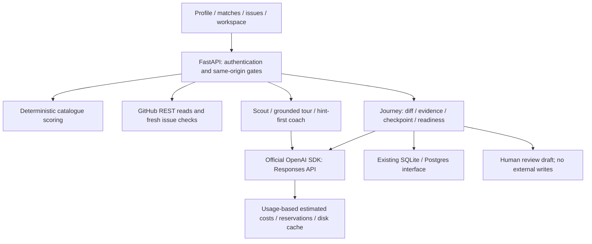

# Delivered architecture — October 10, 2026

The existing FastAPI + no-build React architecture remains. The browser loads independent JSX components through Babel; static assets are served under `/static`. No framework migration, catalogue expansion or external publication was performed.

## Primary inference

`backend/llm.py` preserves `ask(tier, system, messages, max_tokens, session_id, effort, use_cache)` for existing callers. `effort` remains a compatibility argument; the configured non-reasoning GPT-4.1 models receive no incompatible Claude effort flags. Requests use `responses.create(model, instructions, input, max_output_tokens, store=False)`, and `output_text`, `status` and response usage are read from the SDK result. Requests time out after 45 seconds and do not automatically retry (avoids invisible duplicate spending).

`OPENAI_API_KEY` is server-only. Missing key, authentication and provider errors become explicit API/NDJSON errors. Raw OpenAI diagnostics are not sent to the UI. If usage is missing, the reserved estimate is charged without fabricating token counts and the request fails visibly. Incomplete/empty/refused answers are charged from usage, not cached or presented as successful replies. Disk cache keys include provider version, user, model, prompts and output limit, so old Claude responses cannot be reused as OpenAI output.

Estimated costs use documented input/output/cached-input prices in `config.PRICES`. OpenAI input usage includes cached tokens, which are subtracted from normal input before charging cached input. No Anthropic cache-write multipliers remain. Unknown model prices block before a request. A conservative UTF-8 byte estimate plus overhead reserves estimated input/output cost under a lock; reported usage reconciles it. Budgets and UI values are estimates. Existing per-process reservation concurrency protection is retained; multi-process/database budget reservation is not atomic and is a production limitation.

References checked October 10: [Responses API](https://developers.openai.com/api/reference/python/resources/responses/methods/create), [GPT-4.1 mini](https://developers.openai.com/api/docs/models/gpt-4.1-mini), [GPT-4.1](https://developers.openai.com/api/docs/models/gpt-4.1). Documented IDs were verified; account access and actual inference were not, because `OPENAI_API_KEY` was absent.

## Issue and source evidence

`github.verify_issue` refreshes issue, timeline and comment reads on entry. It reports state, assignees, open linked PRs, recent claims and their source links, unchecked portions and UTC timestamp. Comment failures become unknown rather than no claim. Inspections are bounded; a full first timeline/comments page is flagged as incomplete. Search filters are candidate discovery, not proof of availability.

Policy scanning is a bounded keyword inspection of existing policy paths, with source URLs. It separates explicit restriction signals, AI guidance requiring inspection, no restriction found in inspected files, and unknown/no files. It is not a legal judgement. GitHub errors remain errors. Journey entry refreshes policy files. Readiness requires a complete check no older than five minutes and no restriction found in the inspected policy; other policy states withhold readiness.

Repository tours use fetched README, contribution text and the directory listing, not invented source. The review fetches up to five requested repository-relative files (5,000 characters each, with truncation/missing labels); coaching uses the saved issue, overview, sources and student diff/evidence. Repository/model content is untrusted data, and markdown is sanitised by the existing renderer. No downloaded repository code is executed.

## Guided state and checkpoint

`backend/journey.py` adds one JSON payload table through `backend/db.py`, keyed by user/repository/issue. Existing storage and authentication patterns are reused. Profile export/deletion includes this data. APIs: `POST /api/journey/begin`, `GET /api/journey`, `POST /api/journey/save`, `/sources`, `/checkpoint`.

Review contains issue and policy evidence, unified diff, parsed changed files, student evidence, PR description, disclosure and checkpoint. Evidence has a fixed server-issued student-supplied label; a browser cannot claim runner provenance. This build has no executed guided-runner evidence. Self-reported guide checkboxes do not determine readiness.

Questions derive from the saved issue/diff. Strictly validated JSON accepts 2–3 questions and one boolean-plus-feedback result per answer; invalid model output cannot complete the checkpoint. Failed answers retain targeted feedback and allow retry. Checkpoint records the diff SHA-256. Diff/evidence edits or changed issue/policy invalidate it. Conditional SQL writes compare the previous payload so a concurrent edit cannot attach old evaluation to a new review. Readiness is computed, never accepted as a client field. The browser withholds readiness on unsaved edits and expired verification.

The checkpoint is a learning aid, not proof of competence. Prompted evaluation can be wrong; human review is still required. Test evidence, local checkout identity, CI and maintainer acceptance remain unverified. Downloading a draft does not publish anything.

## Preserved gates and legacy worker

OAuth identity, hosted sign-in, same-origin protection, public deployment configuration gates, user-scoped storage and reply sending controls remain. Public/serverless hosting requires Postgres and encrypted sessions. `AUTO_POST_REPLIES=false` remains the default.

Full-auto is unavailable: the interview omits it, `/api/jobs` rejects new jobs and health reports false. Existing jobs and human approval endpoints remain for prior state; tests temporarily enable job creation only inside isolated fixtures to exercise legacy safety. `runner.py` remains a Claude Code worker, not a Codex/OpenAI migration. Its sandbox, token isolation, limits, cancellation, policy checks, diff checks and approval tests remain. Do not use it for the hackathon demo or run unfamiliar scripts on the host.

## Controlled demonstration

`python -m backend.demo` launches only on loopback port 8001, uses separate SQLite state and controlled source files, and substitutes scripted OpenAI/GitHub responses. Its prominent banner and health flag distinguish it from live integration. `tools/demo_walkthrough.py` refuses to reset a non-fixture server, exercises the real browser/components/API/storage, and records desktop/narrow captures plus a WebM. `demo/test-evidence.json` records actual before/after execution in a disposable directory. These results are not third-party contribution evidence. CDN assets require network/cache; the recording is the network-independent fallback.
